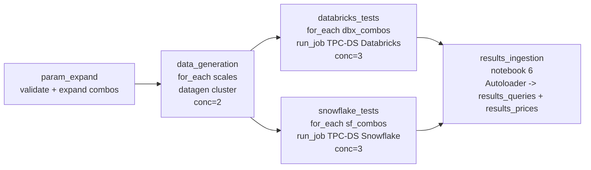
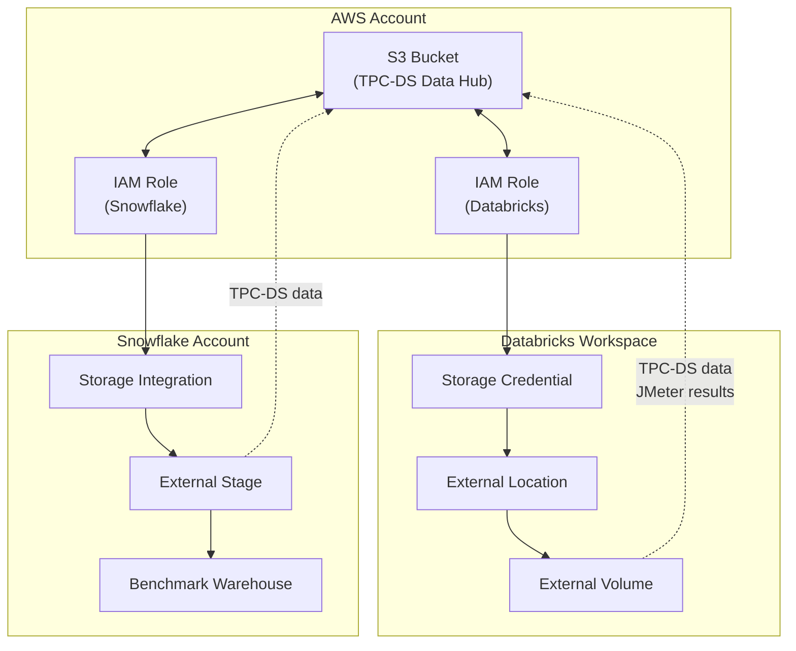

# TPC-DS Benchmark: Databricks vs Snowflake

A reproducible benchmarking framework for comparing Databricks and Snowflake performance using the TPC-DS workload. This project provisions shared infrastructure on AWS and runs standardized queries to generate objective performance and cost comparisons.

For methodology details on ensuring fair comparison, see [docs/methodology.md](docs/methodology.md).

## Table of Contents

- [Quickstart](#quickstart)
- [Prerequisites](#prerequisites)
- [Architecture](#architecture)
- [Parameter Reference](#parameter-reference)
- [Additional Documentation](#additional-documentation)

## Quickstart

### Step 1 of 4: Clone and Configure

1. Clone this repository:
   ```bash
   git clone https://github.com/your-org/tpcds-benchmark.git
   cd tpcds-benchmark
   ```

2. Copy the example variables file:
   ```bash
   cp terraform/terraform.tfvars.example terraform/terraform.tfvars
   ```

3. Edit `terraform/terraform.tfvars` and set the required values:
   ```hcl
   # Provider profiles (configured in Step 2)
   aws_profile        = "tpcds-dev"
   databricks_profile = "tpcds-dev"
   snowflake_profile  = "tpcds-dev"

   # AWS - S3 bucket name must be globally unique
   s3_bucket_name = "tpcds-benchmark-yourcompany-dev"

   # Databricks
   databricks_workspace_url = "https://dbc-xxxxxxx.cloud.databricks.com"
   databricks_account_id    = "your-account-id"

   # Snowflake - Found in account URL: https://orgname-accountname.snowflakecomputing.com
   snowflake_organization = "YOUR_ORG"
   snowflake_account      = "YOUR_ACCOUNT"
   snowflake_user         = "SVC_JMETER"
   ```

   Other parameters have sensible defaults. See [Parameter Reference](#parameter-reference) for the full list.

### Step 2 of 4: Deploy Infrastructure

1. Configure CLI profiles (all three providers authenticate via profile, not env vars):
   ```bash
   # AWS
   aws sso login --profile tpcds-dev
   # or: aws configure --profile tpcds-dev

   # Databricks
   databricks auth login --host https://dbc-xxx.cloud.databricks.com --profile tpcds-dev

   # Snowflake (CLI v2+; writes to ~/.snowflake/config.toml)
   snow connection add tpcds-dev \
     --account <org>-<acct> --user <admin_user> \
     --authenticator SNOWFLAKE_JWT --private-key-file /path/to/admin_rsa_key.p8
   ```

2. Initialize and apply Terraform:
   ```bash
   cd terraform
   terraform init
   terraform apply
   ```

   A single `terraform apply` provisions all resources across AWS, Databricks, and Snowflake.

### Step 3 of 4: Run Benchmarks

Run **`0 - Job Setup.ipynb`** once to create three Databricks Jobs:

1. **TPC-DS Databricks** — single-combo Databricks pipeline (CREATE TABLE + OPTIMIZE/ZORDER/ANALYZE → JMeter ingestion + power + concurrency). `max_concurrent_runs=5`, queued.
2. **TPC-DS Snowflake** — single-combo Snowflake pipeline (CREATE TABLE + COPY INTO → JMeter ingestion + power + concurrency). `max_concurrent_runs=5`, queued.
3. **TPC-DS Full Benchmark** — the orchestrator. DAG:



- `param_expand` runs `helpers/expand_benchmark_params.ipynb` first — it validates every job parameter (scales, sizes, strategies, concurrency) with explicit error messages and cross-checks the concurrency values against each child job's `max_concurrent_runs` via the Databricks SDK. If any parameter is invalid, the job fails here, at the start, with a clear message. It also scans the volume per scale and emits `scales_to_generate_json` so `data_generation` only generates scales that aren't already on the volume.
- `data_generation` is a `for_each` task iterating *missing* scales on a long-lived `datagen` cluster (so the cluster never auto-terminates between scales). If every requested scale is already on the volume, the for_each runs zero iterations and the cluster never starts.
- `databricks_tests` and `snowflake_tests` are two independent `for_each` tasks that run in parallel; each is capped by its own concurrency widget (default 3) and by the child job's `max_concurrent_runs` (default 5).
- `results_ingestion` runs `6 - Results Comparison.ipynb` once both branches complete on serverless. See [Step 4](#step-4-of-4-view-results) for what it produces.
- `pricing_update` runs `6.1 - Pricing Update.ipynb` after `results_ingestion` to refresh the `results_prices` table with current AWS pricing for every (platform, size, gen, region, tier) combination.

Trigger the orchestrator with either defaults (1×1×1 smoke run) or explicit arrays:

```bash
# smoke run
databricks jobs run-now <orch-job-id>

# full matrix: 2 scales × 4 sizes × 3 dbx strategies × 4 sf strategies
databricks jobs run-now <orch-job-id> \
  --params 'scales=100,1000' \
  --params 'sizes=S,M,L,XL' \
  --params 'dbx_strategies=zorder,liquid clustering,iceberg,iceberg_liquid_clustering,iceberg_zordered' \
  --params 'sf_strategies=native_gen1,native_gen2,iceberg_gen1,iceberg_gen2,native_gen2_adaptive,iceberg_gen2_adaptive' \
  --params 'max_clusters=1'
```

Every (scale, size, strategy) combination gets its own:
- SQL warehouse named `TPCDS_{scale}_{size}_{STRATEGY_SLUG}` (Snowflake sets `GENERATION` explicitly for `native_gen*`/`iceberg_gen*`)
- `max_clusters` (default 1): fixed warehouses set `MAX_CLUSTER_COUNT`/`max_num_clusters`; `*_gen2_adaptive` strategies create an **adaptive** warehouse (`WAREHOUSE_TYPE='ADAPTIVE'`) where `size` = per-query cap (`MAX_QUERY_PERFORMANCE_LEVEL`) and `max_clusters` = throughput (`QUERY_THROUGHPUT_MULTIPLIER`, must be 0 or ≥2)
- Ingestion table namespace (`table_prefix = {size}_{scale}_{STRATEGY_SLUG}_`)
- Per-combo JMX/TSV subdirectory under `/Volumes/.../test_files/{prefix}/`
- Per-combo result CSVs and JMeter logs on the volume (filename-prefixed)
- MLflow run name (`{prefix}-{platform}_{test_type}`)

#### Cleaning up between runs

- **`7 - Databricks - Cleanup`** — drops every table/view in the Databricks benchmark schema **except tables prefixed with `results_`** (so the results history persists). Leaves the volume, storage credential, external location, and raw data intact.
- **`7.1 - Snowflake - Cleanup`** — drops every table/view in the Snowflake schema. Leaves the stage, file format, storage integration, and warehouses intact.

Both cleanup notebooks accept:
- `table_prefix` (optional) — when set, only tables/views matching that prefix are dropped (e.g. `M_100_ZORDER_` drops just that combo; empty drops everything except `results_*`)
- `dry_run` (default `false`) — `true` prints the DROP statements without executing

Example commands:
```bash
# preview what would be dropped from a single Databricks combo
databricks jobs submit --json '{"run_name":"cleanup preview","tasks":[{"task_key":"t",
  "notebook_task":{"notebook_path":"/.../7 - Databricks - Cleanup",
    "base_parameters":{"table_prefix":"M_100_ZORDER_","dry_run":"true"}}}]}'
```

### Step 4 of 4: View Results

Benchmark results land in two Delta tables under the Databricks catalog (`tpcds_sf_catalog.tpcds` by default):

| Table | Contents | Produced by |
|---|---|---|
| `results_queries` | One row per JMeter sample: `platform`, `scale`, `warehouse_size`, `warehouse_size_type`, `max_clusters`, `strategy_slug`, `optimization_strategy`, `data_format`, `test_type`, `q_id`, `label_raw`, `stream_id`, `start_time`, `end_time`, `duration_ms`, plus JMeter fields (`success`, `response_code`, `bytes`, `latency_ms`, …), `source_file`, `ingested_at` | Autoloader reads `{volume}/results/*.csv` → `foreachBatch` parses the filename (`{SIZE}_{SCALE}_{MAXCLUSTERS}_{SLUG}-{PLATFORM}-{TEST_TYPE}-report.csv`) and normalises JMeter's camelCase into snake_case |
| `results_prices` | One row per distinct `(platform, warehouse_size, warehouse_size_type, region)`; columns `price_per_unit`, `units_per_hour`, `unit_label` (`DBU`/`credit`). Defaults are `0` — edit rows by hand to compute TCO | `MERGE … WHEN NOT MATCHED THEN INSERT` from `results_queries`; existing rows are never overwritten, so your manual edits survive re-runs |

**When the results land:** the orchestrator's `results_ingestion` task runs notebook 6 automatically at the end of the DAG, and `pricing_update` runs notebook 6.1 right after to refresh prices.

**q_id vocabulary** (same on both platforms, so `JOIN ON q_id` works directly):
- `ingestion`: `create_<table>` (24 rows per platform)
- `optimize`: `optimize_<table>` / `analyze_<table>` (Databricks only — Snowflake handles this automatically)
- `power`: `q1`…`q99`, plus variants like `q14a`, `q14b`, `q23a`, `q23b` (103 rows)
- `concurrency`: same `qN` values, with the stream number in a dedicated `stream_id` column and the original JMeter label (`"q3 (stream 13)"`) kept in `label_raw`

**Idempotence.** Autoloader uses a checkpoint at `{volume}/autoloader/results/` — re-running notebook 6 only picks up new CSVs. To force a full re-ingest, drop `results_queries` and wipe `{volume}/autoloader/`.

**Dashboard.** A Lakeview dashboard is committed at `dashboards/tpcds_benchmark_comparison.lvdash.json` — deploy it via `databricks api post /api/2.0/lakeview/dashboards` (and `/<id>/published` to publish) to get a per-platform / per-strategy comparison view of cost and duration.

### Running benchmarks from your laptop (advanced)

> The orchestrator job is the only **supported** entry point. This section is for users who genuinely need to drive the load from their own host — for example, a controlled load-gen environment outside the Databricks workspace, or an air-gapped compliance scenario. Everything in this section is best-effort; you keep the pieces.

The benchmark is just JMeter + JDBC. The Databricks job builds the JMX/TSV files, stages JMeter and the drivers, and runs `jmeter -n -t …` on a Databricks single-node cluster. You can do the same from your laptop with the artifacts the orchestrator already generates.

#### 1. Generate the artifacts in Databricks

Run `0 - Job Setup` once, then trigger the orchestrator at least once for the (size, scale, strategy) combo you want to benchmark. After the run finishes, the per-combo JMX + TSV bundle lives on the UC volume:

```
/Volumes/{catalog}/{schema}/tpcds_raw_data/test_files/{PREFIX}/
```

where `PREFIX = {SIZE}_{SCALE}_{MAXCLUSTERS}_{STRATEGY_SLUG}` (e.g. `M_100_ZORDER`, `M_100_NATIVE_GEN1`).

The cached JMeter binary and JDBC drivers are in:

```
/Volumes/{catalog}/{schema}/tpcds_raw_data/tmp/
```

#### 2. Files to copy to your laptop

| Volume path | Contents | Notes |
|---|---|---|
| `tmp/apache-jmeter-5.6.3.tgz` | JMeter 5.6.3 | Extract; needs Java 11+ |
| `tmp/DatabricksJDBC-3.3.1.zip` | Databricks JDBC driver | Unzip to get `DatabricksJDBC.jar` |
| `tmp/snowflake-jdbc-4.1.0.jar` | Snowflake JDBC driver | Use as-is |
| `test_files/{PREFIX}/databricks_ingestion.jmx` | DBX ingestion JMX | One per combo |
| `test_files/{PREFIX}/databricks_perf_test.jmx` | DBX power test JMX | |
| `test_files/{PREFIX}/databricks_concurrency.jmx` | DBX concurrency JMX | |
| `test_files/{PREFIX}/snowflake_ingestion.jmx` | SF ingestion JMX | |
| `test_files/{PREFIX}/snowflake_perf_test.jmx` | SF power test JMX | |
| `test_files/{PREFIX}/snowflake_concurrency.jmx` | SF concurrency JMX | |
| `test_files/{PREFIX}/tpcds-queries-ingestion-databricks.tsv` | DBX ingestion query bundle | Referenced by the JMX |
| `test_files/{PREFIX}/tpcds-queries-optimization-databricks.tsv` | DBX OPTIMIZE bundle | (Currently run via SDK from notebook 5a — unused if you're driving JMeter only) |
| `test_files/{PREFIX}/tpcds-queries-analyze-databricks.tsv` | DBX ANALYZE bundle | Same |
| `test_files/{PREFIX}/tpcds-queries-power-databricks.tsv` | DBX power test queries | |
| `test_files/{PREFIX}/tpcds-queries-concurrency-databricks.tsv` | DBX concurrency queries | |
| `test_files/{PREFIX}/tpcds-queries-*-snowflake.tsv` | SF query bundles | |
| `test_files/rsa_key.p8` | Snowflake RSA private key | Keypair auth for `SVC_JMETER` |

Convenience copy (replace `M_100_ZORDER` and `M_100_NATIVE_GEN1` with your combos):

```bash
mkdir -p local-tpcds && cd local-tpcds
databricks fs cp -r dbfs:/Volumes/tpcds_sf_catalog/tpcds/tpcds_raw_data/test_files/M_100_ZORDER ./test_conf
databricks fs cp -r dbfs:/Volumes/tpcds_sf_catalog/tpcds/tpcds_raw_data/test_files/M_100_NATIVE_GEN1 ./test_conf-sf
databricks fs cp -r dbfs:/Volumes/tpcds_sf_catalog/tpcds/tpcds_raw_data/tmp ./drivers
databricks fs cp dbfs:/Volumes/tpcds_sf_catalog/tpcds/tpcds_raw_data/test_files/rsa_key.p8 ./test_conf/rsa_key.p8
```

#### 3. Local prerequisites

- Java 11 (`apt-get install openjdk-11-jre-headless` on Linux, or use SDKMAN).
- Extract JMeter and the Databricks driver:
  ```bash
  tar -xzf drivers/apache-jmeter-5.6.3.tgz
  unzip -j drivers/DatabricksJDBC-3.3.1.zip "*.jar" -d ./drivers/
  # ./drivers/DatabricksJDBC.jar and ./drivers/snowflake-jdbc-4.1.0.jar are now ready
  ```

#### 4. Path rewrites in the JMX (mandatory)

The JMX files were generated with absolute paths that point at the Databricks cluster filesystem. Two paths need rewriting:

| Token in the JMX | Original (cluster) value | Rewrite to (local) |
|---|---|---|
| Driver paths | `/tpcds/db_driver.jar`, `/tpcds/sf_driver.jar` | The full path of `DatabricksJDBC.jar` / `snowflake-jdbc-4.1.0.jar` on your laptop |
| Volume root | `/Volumes/{catalog}/{schema}/{volume}/test_files/{PREFIX}` and `/Volumes/{catalog}/{schema}/{volume}` | The local directory holding your TSV files (e.g. `./test_conf` and its parent) |

Example with `sed` (portable form — works on macOS and Linux):

```bash
LOCAL_ROOT=$(pwd)
for jmx in test_conf/*.jmx test_conf-sf/*.jmx; do
  python3 -c "
import sys
p = sys.argv[1]
s = open(p).read()
s = s.replace('/tpcds/db_driver.jar', '${LOCAL_ROOT}/drivers/DatabricksJDBC.jar')
s = s.replace('/tpcds/sf_driver.jar', '${LOCAL_ROOT}/drivers/snowflake-jdbc-4.1.0.jar')
s = s.replace('/Volumes/tpcds_sf_catalog/tpcds/tpcds_raw_data/test_files/M_100_ZORDER', '${LOCAL_ROOT}/test_conf')
s = s.replace('/Volumes/tpcds_sf_catalog/tpcds/tpcds_raw_data/test_files/M_100_NATIVE_GEN1', '${LOCAL_ROOT}/test_conf-sf')
s = s.replace('/Volumes/tpcds_sf_catalog/tpcds/tpcds_raw_data', '${LOCAL_ROOT}/test_conf')
open(p, 'w').write(s)
" "$jmx"
done
```

The same rewrites are exactly what notebook `5a - Databricks - Ingestion` (and the Snowflake equivalent) do at runtime when copying JMX files to `/tmp/tpcds` on the cluster — that's why local execution needs them too.

You also need to confirm the Snowflake JMX points to your local `rsa_key.p8` (not the volume path). The file format is the same; only the path string changes.

#### 5. Run a phase

```bash
mkdir -p results logs
JAVA_HOME=$(/usr/libexec/java_home -v 11) \
apache-jmeter-5.6.3/bin/jmeter -n \
  -t test_conf/databricks_ingestion.jmx \
  -l results/M_100_ZORDER-databricks-ingestion-report.csv \
  -j logs/jmeter-dbx-ingestion.log
```

Run order: `*_ingestion.jmx` → `*_perf_test.jmx` → `*_concurrency.jmx` per platform. The ingestion phase populates the tables on the warehouse; the other two phases assume those tables exist.

Two practical caveats:

- **Databricks `OPTIMIZE` / `ANALYZE`** are out-of-band on the orchestrator side: notebook 5a runs them via the SDK Statement Execution API after JMeter ingestion, not via JMeter (the Databricks JDBC driver doesn't support `Callable Statement` cleanly for these). If you skip notebook 5a's behaviour, run them yourself against the warehouse after ingestion finishes; otherwise the power-test results won't be representative. The exact statements live in `test_files/{PREFIX}/tpcds-queries-optimization-databricks.tsv` and `…-analyze-databricks.tsv`.
- **Warehouses** must already exist (named `TPCDS_{scale}_{size}_{STRATEGY_SLUG}`) and be accessible from your laptop. The orchestrator creates them on first benchmark run via `find_or_create_*_warehouse` helpers.

#### 6. Ingest the local results back into Databricks

Once you have local result CSVs that follow the canonical filename
`{SIZE}_{SCALE}_{MAXCLUSTERS}_{STRATEGY_SLUG}-{platform}-{test_type}-report.csv`, upload them to the volume and run notebook 6:

```bash
databricks fs cp results/*.csv dbfs:/Volumes/tpcds_sf_catalog/tpcds/tpcds_raw_data/results/
# then in Databricks: run "6 - Results Comparison.ipynb"
# then "6.1 - Pricing Update.ipynb" if you want fresh prices
```

Autoloader's checkpoint will pick the new CSVs up on the next run; the dashboard updates automatically.

The notebook code is still the source of truth for query bundles, JMeter wiring, and warehouse provisioning. Running on your laptop just means executing the JMX it generates on different compute.

## Prerequisites

Before starting, ensure you have:

- [ ] **Terraform** >= 1.5.0
  <details>
  <summary>Installation</summary>

  Install from [HashiCorp Downloads](https://developer.hashicorp.com/terraform/install)

  Verify: `terraform version`
  </details>

- [ ] **AWS CLI** configured with credentials
  <details>
  <summary>Required IAM permissions</summary>

  Your AWS credentials need these permissions:
  - `s3:CreateBucket`
  - `s3:PutObject`
  - `s3:GetObject`
  - `s3:DeleteObject`
  - `s3:ListBucket`
  - `iam:CreateRole`
  - `iam:AttachRolePolicy`
  - `iam:DeleteRole`
  - `iam:PutRolePolicy`
  - `iam:GetRole`
  - `iam:PassRole`

  Alternatively, use `AdministratorAccess` for simplicity.
  </details>

- [ ] **Databricks workspace** with Unity Catalog enabled
  <details>
  <summary>Required privileges</summary>

  - Account admin access (for storage credentials)
  - `CREATE STORAGE CREDENTIAL` privilege
  - `CREATE EXTERNAL LOCATION` privilege
  - `CREATE VOLUME` privilege on target schema
  - Workspace must be assigned to a Unity Catalog metastore
  - Access token from: User Settings > Developer > Access tokens
  </details>

- [ ] **Snowflake account**
  <details>
  <summary>Required privileges and one-time admin setup</summary>

  An ACCOUNTADMIN (or someone with the role-creation chain) needs to run the
  following once to create a dedicated benchmark role. Substitute `TPCDS_ROLE`
  and `<your_user>` with your preferred names; after the final statement, the
  role becomes self-owning and `<your_user>` can grant it to additional users
  without further admin involvement.

  ```sql
  USE ROLE SECURITYADMIN;
  CREATE ROLE IF NOT EXISTS TPCDS_ROLE;
  GRANT ROLE TPCDS_ROLE TO ROLE SYSADMIN;

  USE ROLE ACCOUNTADMIN;
  GRANT CREATE DATABASE        ON ACCOUNT TO ROLE TPCDS_ROLE;
  GRANT CREATE WAREHOUSE       ON ACCOUNT TO ROLE TPCDS_ROLE;
  GRANT CREATE INTEGRATION     ON ACCOUNT TO ROLE TPCDS_ROLE;
  GRANT CREATE EXTERNAL VOLUME ON ACCOUNT TO ROLE TPCDS_ROLE;
  GRANT CREATE USER            ON ACCOUNT TO ROLE TPCDS_ROLE;
  GRANT CREATE ROLE            ON ACCOUNT TO ROLE TPCDS_ROLE;
  GRANT IMPORTED PRIVILEGES ON DATABASE SNOWFLAKE TO ROLE TPCDS_ROLE;

  USE ROLE SECURITYADMIN;
  GRANT ROLE TPCDS_ROLE TO USER <your_user>;
  GRANT OWNERSHIP ON ROLE TPCDS_ROLE TO ROLE TPCDS_ROLE COPY CURRENT GRANTS;
  ```

  Also required: Snowflake CLI v2+ (`snow`) installed locally, and a service
  user with RSA keypair auth for the benchmark runs (created from the benchmark
  role above — terraform does not create users; see [docs/methodology.md](docs/methodology.md)).
  </details>

## Architecture

The benchmark uses AWS S3 as a central data hub, with both Databricks and Snowflake accessing the same TPC-DS data through their respective access mechanisms.



**Data flow:**
- TPC-DS data is generated and stored in S3
- Databricks accesses data via Unity Catalog external volumes
- Snowflake accesses data via external stages
- Both platforms run identical queries for fair comparison

## Parameter Reference

### Required Parameters

These parameters must be set in `terraform/terraform.tfvars`:

| Variable | Description | Example |
|----------|-------------|---------|
| `aws_profile` | AWS CLI profile name (`~/.aws/credentials` or SSO) | `tpcds-dev` |
| `databricks_profile` | Databricks CLI profile name (`~/.databrickscfg`) | `tpcds-dev` |
| `snowflake_profile` | Snowflake CLI v2 profile name (`~/.snowflake/config.toml`) | `tpcds-dev` |
| `s3_bucket_name` | Globally unique S3 bucket name for TPC-DS data | `tpcds-benchmark-yourcompany-dev` |
| `databricks_workspace_url` | Databricks workspace URL | `https://dbc-xxx.cloud.databricks.com` |
| `databricks_account_id` | Databricks account ID | `12345678-abcd-efgh` |
| `snowflake_organization` | Snowflake org name from account URL | `MYORG` |
| `snowflake_account` | Snowflake account name from account URL | `MYACCOUNT` |
| `snowflake_user` | Customer-managed service account used by JMeter | `SVC_JMETER` |

### Optional Parameters

These parameters have sensible defaults:

| Variable | Description | Default |
|----------|-------------|---------|
| `environment` | Environment name (dev, staging, prod) | `dev` |
| `project_prefix` | Prefix for resource names | `tpcds` |
| `aws_region` | AWS region for resources | `us-east-1` |
| `s3_enable_versioning` | Enable S3 bucket versioning | `true` |
| `iceberg_s3_prefix` | S3 prefix for Snowflake managed-Iceberg data | `iceberg/` |
| `databricks_catalog` | Unity Catalog catalog name (created by terraform) | `tpcds_sf_catalog` |
| `databricks_schema` | Unity Catalog schema name (created by terraform) | `tpcds` |
| `databricks_volume_name` | External volume name for TPC-DS data | `tpcds_raw_data` |
| `snowflake_database_name` | Snowflake database name | `TPCDS` |
| `snowflake_schema_name` | Snowflake schema name | `BENCHMARK` |
| `snowflake_service_role` | Snowflake role that receives grants and runs the benchmark | `SYSADMIN` |

Benchmark-time parameters (scale factors, warehouse sizes, optimize strategies) are
set at the Databricks workflow level, not in terraform. See the orchestrator
trigger example above.

## Additional Documentation

- **[terraform/README.md](terraform/README.md)** - Detailed Terraform documentation including troubleshooting, security best practices, and provider configuration
- **[docs/methodology.md](docs/methodology.md)** - Fair comparison methodology explaining same-region deployment, equivalent compute tiers, and cache-disabled testing

---

*Results are specific to the TPC-DS workload and may not reflect performance for other use cases.*
