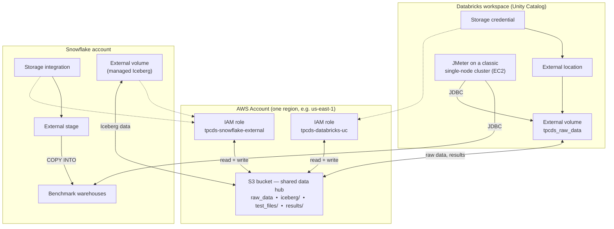
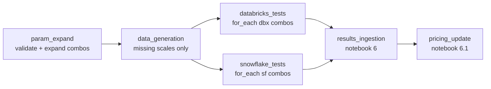

# TPC-DS Benchmark: Databricks vs Snowflake

A reproducible framework for comparing **Databricks** and **Snowflake** on the TPC-DS
workload. The same generated dataset lives in a single S3 bucket that both platforms
read from and write to, the same SQL is driven through each platform's JDBC driver by
[Apache JMeter](https://jmeter.apache.org/), and the results are collected into Delta
tables so you can compare **duration and cost** — down to the individual query.

For the fair-comparison methodology (same region, equivalent compute tiers,
cache-disabled testing), see [docs/methodology.md](docs/methodology.md).

## Table of Contents

- [Architecture](#architecture)
- [How the benchmark runs](#how-the-benchmark-runs)
- [Pricing & cost analysis](#pricing--cost-analysis)
- [Prerequisites](#prerequisites)
- [Infrastructure setup (step by step)](#infrastructure-setup-step-by-step)
  - [1. Create the shared S3 bucket](#1-create-the-shared-s3-bucket)
  - [2. Give Databricks read/write access](#2-give-databricks-readwrite-access)
  - [3. Give Snowflake read/write access](#3-give-snowflake-readwrite-access)
  - [4. Lock the bucket policy to both roles](#4-lock-the-bucket-policy-to-both-roles)
  - [5. Create the Snowflake file format and stage](#5-create-the-snowflake-file-format-and-stage)
- [Configure the project](#configure-the-project)
- [Run the benchmark](#run-the-benchmark)
- [Results & dashboards](#results--dashboards)
- [Running JMeter from your laptop](#running-jmeter-from-your-laptop)
- [Cleanup](#cleanup)
- [Configuration reference](#configuration-reference)

## Architecture

The benchmark treats **AWS S3 as a shared data hub**. TPC-DS data is generated once and
landed in the bucket; both engines then create their tables from that same data and run
identical query streams against their own compute. Crucially, **both platforms need read
*and* write** on the bucket:

- **Databricks** writes the generated raw data, the JMeter result CSVs, and (for the
  Iceberg strategies) table data; it reads the raw data during ingestion.
- **Snowflake** reads the raw data via an external stage (`COPY INTO`), and writes
  managed-Iceberg table data and metadata under the `iceberg/` prefix via an external
  volume.



**Data flow:**
1. A Databricks cluster generates TPC-DS data with `dsdgen` and writes pipe-delimited
   CSV to the volume (→ S3), one folder per table per scale.
2. Each platform creates its benchmark tables from that data — Databricks via
   `CREATE TABLE … AS SELECT`, Snowflake via `COPY INTO` from the external stage.
3. JMeter drives three query phases (ingestion, power, concurrency) over JDBC against
   each platform's warehouse.
4. Result CSVs land in `results/` on the bucket; Databricks Auto Loader ingests them
   into Delta tables, and live pricing is merged in for cost analysis.

## How the benchmark runs

The orchestration is a set of Databricks Jobs (created by `0 - Job Setup.ipynb`). The
query load itself is generated by **Apache JMeter 5.6.3**, which talks to each platform
through its JDBC driver (Databricks Simba JDBC 3.3.1, Snowflake JDBC 4.1.0).

**JMeter runs on a classic (non-serverless) single-node cluster.** JMeter is a JVM load
generator and needs a real machine, so the test tasks run on a classic Databricks job
cluster — effectively a single EC2 instance inside your own cloud account:

```python
# from "0 - Job Setup.ipynb"
JMETER_CLUSTER = {
    "spark_version": "15.4.x-scala2.12",
    "node_type_id":  "m-fleet.4xlarge",   # a real EC2 VM
    "num_workers":   0,                    # single node
    "spark_conf":    {"spark.master": "local[*]",
                      "spark.databricks.cluster.profile": "singleNode"},
    "data_security_mode": "SINGLE_USER",
}
```

You don't have to run JMeter inside Databricks, though — the job generates the `.jmx`
test plans and the query bundles as plain files on the volume, so you can **download
them and run the tests from your own laptop** (or any controlled load-gen host) instead.
See [Running JMeter from your laptop](#running-jmeter-from-your-laptop).

**The three phases** (identical on both platforms, driven query-for-query via JDBC):

| Phase | What it does |
|---|---|
| **Ingestion** | Creates and loads the TPC-DS tables (`CREATE TABLE AS SELECT` on Databricks; `COPY INTO` on Snowflake). On Databricks, `OPTIMIZE`/`ANALYZE` run out-of-band via the Statement Execution API; Snowflake collects statistics automatically. |
| **Power test** | Runs the 99 TPC-DS queries (`q1`…`q99`, plus `a`/`b` variants) single-threaded — single-user analytical latency. |
| **Concurrency** | Replays the queries across multiple parallel streams — multi-user throughput under load. |

## Pricing & cost analysis

**Prices are pulled automatically from each vendor's public pricing endpoint** at runtime
by `6.1 - Pricing Update.ipynb` — you don't hand-enter rates:

- **Databricks:** `https://www.databricks.com/en-pricing-assets/data/pricing/AWS.json`
  (per-region `$/DBU` and per-size `DBU/hour`).
- **Snowflake:** the public pricing-calculator JSON on `snowflake.com` (per-region
  `$/credit` and per-size `credits/hour`; Gen2 is derived with the documented AWS
  multiplier).

**You choose which tiers to compare.** Every tier is fetched and stored, and you pick the
one to price against from the dashboard:

- Databricks: **Premium** or **Enterprise**
- Snowflake: **Standard**, **Enterprise**, or **Business Critical**

**Use the dashboard for the at-a-glance comparison, but query the tables to really drill
down.** The committed Lakeview dashboard
(`dashboards/tpcds_benchmark_comparison.lvdash.json`) gives you per-phase and per-query
cost/duration charts with tier and strategy selectors. For anything deeper — including
**cost per individual query** — query the result tables directly. Cost is computed as:

```text
cost_usd = duration_ms / 3_600_000 * units_per_hour * price_per_unit
```

so a per-query cost comparison is just a join between `results_queries` and
`results_prices` (see [Results & dashboards](#results--dashboards) for an example).

## Prerequisites

| Requirement | Notes |
|---|---|
| **AWS account** | Permissions to create an S3 bucket, IAM roles, IAM role policies, and a bucket policy. `AdministratorAccess` is simplest; the minimum is `s3:CreateBucket`/`PutBucketPolicy`, `iam:CreateRole`/`PutRolePolicy`/`GetRole`. |
| **Databricks workspace** | Unity Catalog enabled and assigned to a metastore. You need `CREATE STORAGE CREDENTIAL`, `CREATE EXTERNAL LOCATION`, and `CREATE VOLUME`, plus a workspace PAT (User Settings → Developer → Access tokens). |
| **Snowflake account** | `ACCOUNTADMIN` (or a role with `CREATE INTEGRATION`, `CREATE EXTERNAL VOLUME`, `CREATE DATABASE`, `CREATE WAREHOUSE`) for the one-time setup, plus a service user with RSA key-pair auth for the benchmark runs. |
| **Local tooling** | AWS CLI, Databricks CLI, `git`, and Python 3.9+. (JMeter and the JDBC drivers are downloaded automatically by the job; you only need them locally if you run from your laptop.) |

<details>
<summary>One-time Snowflake benchmark role (optional but recommended)</summary>

Run once as `ACCOUNTADMIN` to create a self-owning benchmark role so day-to-day runs
don't need admin:

```sql
USE ROLE SECURITYADMIN;
CREATE ROLE IF NOT EXISTS TPCDS_ROLE;
GRANT ROLE TPCDS_ROLE TO ROLE SYSADMIN;

USE ROLE ACCOUNTADMIN;
GRANT CREATE DATABASE        ON ACCOUNT TO ROLE TPCDS_ROLE;
GRANT CREATE WAREHOUSE       ON ACCOUNT TO ROLE TPCDS_ROLE;
GRANT CREATE INTEGRATION     ON ACCOUNT TO ROLE TPCDS_ROLE;
GRANT CREATE EXTERNAL VOLUME ON ACCOUNT TO ROLE TPCDS_ROLE;
GRANT IMPORTED PRIVILEGES ON DATABASE SNOWFLAKE TO ROLE TPCDS_ROLE;

USE ROLE SECURITYADMIN;
GRANT ROLE TPCDS_ROLE TO USER <your_user>;
GRANT OWNERSHIP ON ROLE TPCDS_ROLE TO ROLE TPCDS_ROLE COPY CURRENT GRANTS;
```
</details>

## Infrastructure setup (step by step)

Everything below provisions one shared bucket and wires both platforms to it with
**read and write**. Replace the placeholders in `<angle brackets>` and keep the bucket,
the Databricks workspace, and the Snowflake account **in the same AWS region** (e.g.
`us-east-1`). The names used here match the project defaults
(`tpcds_sf_catalog` / `tpcds` / `tpcds_raw_data`, `TPCDS` / `BENCHMARK`).

> Why read **and** write on both sides? Databricks writes the generated data, the JMeter
> result files, and Iceberg table data; Snowflake reads the data during `COPY INTO` and
> writes managed-Iceberg data/metadata under `iceberg/`. A read-only grant on either side
> will fail the Iceberg strategies and result collection.

### 1. Create the shared S3 bucket

```bash
REGION=us-east-1
BUCKET=<your-tpcds-bucket>          # globally unique

aws s3api create-bucket --bucket "$BUCKET" --region "$REGION" \
  $( [ "$REGION" != "us-east-1" ] && echo --create-bucket-configuration LocationConstraint="$REGION" )

aws s3api put-bucket-versioning --bucket "$BUCKET" \
  --versioning-configuration Status=Enabled

aws s3api put-bucket-encryption --bucket "$BUCKET" \
  --server-side-encryption-configuration \
  '{"Rules":[{"ApplyServerSideEncryptionByDefault":{"SSEAlgorithm":"AES256"}}]}'

aws s3api put-public-access-block --bucket "$BUCKET" \
  --public-access-block-configuration \
  BlockPublicAcls=true,IgnorePublicAcls=true,BlockPublicPolicy=true,RestrictPublicBuckets=true
```

The benchmark uses these prefixes (created on demand — no need to pre-create them):
`raw_data` per scale, `test_files/` (JMeter plans + query bundles), `results/` (JMeter
CSVs), `tmp/` (cached JMeter + JDBC drivers), `autoloader/` (checkpoints), and `iceberg/`
(Snowflake managed-Iceberg data).

### 2. Give Databricks read/write access

Databricks reaches the bucket through a Unity Catalog **storage credential → external
location → external volume** chain, backed by a self-assuming IAM role.

**a. Create the IAM role** (placeholder trust for now; finalized in step *c*) with an
inline S3 policy granting **read + write**:

```json
// s3-rw-policy.json  — attach to both roles
{
  "Version": "2012-10-17",
  "Statement": [{
    "Effect": "Allow",
    "Action": [
      "s3:GetObject", "s3:PutObject", "s3:DeleteObject",
      "s3:ListBucket", "s3:GetBucketLocation"
    ],
    "Resource": [
      "arn:aws:s3:::<your-tpcds-bucket>",
      "arn:aws:s3:::<your-tpcds-bucket>/*"
    ]
  }]
}
```

```bash
ACCOUNT_ID=$(aws sts get-caller-identity --query Account --output text)
DBX_ROLE=tpcds-databricks-uc

# temporary trust so the role can be created; replaced in step c
aws iam create-role --role-name "$DBX_ROLE" \
  --assume-role-policy-document '{"Version":"2012-10-17","Statement":[{"Effect":"Allow","Principal":{"AWS":"arn:aws:iam::'"$ACCOUNT_ID"':root"},"Action":"sts:AssumeRole"}]}'

aws iam put-role-policy --role-name "$DBX_ROLE" \
  --policy-name databricks-uc-s3-access --policy-document file://s3-rw-policy.json
```

**b. Create the storage credential** in Databricks pointing at that role, and note the
**external ID** Databricks generates:

```bash
databricks storage-credentials create --json '{
  "name": "tpcds_storage_credential",
  "aws_iam_role": {"role_arn": "arn:aws:iam::'"$ACCOUNT_ID"':role/tpcds-databricks-uc"}
}'
# -> copy aws_iam_role.external_id from the response
```

**c. Finalize the trust policy** so the role assumes *itself* under that external ID
(the self-assuming-role pattern Unity Catalog expects):

```bash
EXTERNAL_ID=<external-id-from-step-b>
aws iam update-assume-role-policy --role-name "$DBX_ROLE" \
  --policy-document '{
    "Version":"2012-10-17",
    "Statement":[{
      "Effect":"Allow",
      "Principal":{"AWS":"arn:aws:iam::'"$ACCOUNT_ID"':role/tpcds-databricks-uc"},
      "Action":"sts:AssumeRole",
      "Condition":{"StringEquals":{"sts:ExternalId":"'"$EXTERNAL_ID"'"}}
    }]
  }'
```
> Also add a second statement to the inline policy allowing `sts:AssumeRole` on the
> role's own ARN, so the self-assume succeeds. See the
> [Databricks storage-credentials docs](https://docs.databricks.com/en/connect/unity-catalog/storage-credentials.html).

**d. Create the catalog, schema, external location, and volume:**

```bash
databricks catalogs create tpcds_sf_catalog
databricks schemas create tpcds tpcds_sf_catalog

databricks external-locations create --json '{
  "name": "tpcds_external_location",
  "url": "s3://<your-tpcds-bucket>/",
  "credential_name": "tpcds_storage_credential"
}'

databricks volumes create --json '{
  "catalog_name": "tpcds_sf_catalog",
  "schema_name": "tpcds",
  "name": "tpcds_raw_data",
  "volume_type": "EXTERNAL",
  "storage_location": "s3://<your-tpcds-bucket>/"
}'
```

### 3. Give Snowflake read/write access

Snowflake reaches the bucket through a **storage integration** (for the stage) and an
**external volume** (for managed-Iceberg writes), both backed by one IAM role.

**a. Create the storage integration and external volume** (as `ACCOUNTADMIN` or your
benchmark role). Point `STORAGE_AWS_ROLE_ARN` at the role you'll create in step *c*:

```sql
CREATE OR REPLACE STORAGE INTEGRATION TPCDS_S3_INTEGRATION
  TYPE = EXTERNAL_STAGE
  STORAGE_PROVIDER = 'S3'
  ENABLED = TRUE
  STORAGE_AWS_ROLE_ARN = 'arn:aws:iam::<account-id>:role/tpcds-snowflake-external'
  STORAGE_ALLOWED_LOCATIONS = ('s3://<your-tpcds-bucket>/');

CREATE OR REPLACE EXTERNAL VOLUME tpcds_iceberg_volume
  STORAGE_LOCATIONS = (
    (
      NAME = 'tpcds_iceberg_s3'
      STORAGE_PROVIDER = 'S3'
      STORAGE_BASE_URL = 's3://<your-tpcds-bucket>/iceberg/'
      STORAGE_AWS_ROLE_ARN = 'arn:aws:iam::<account-id>:role/tpcds-snowflake-external'
    )
  )
  ALLOW_WRITES = TRUE;
```

**b. Read back the principal and external IDs** Snowflake generated — you need both for
the IAM trust policy:

```sql
DESC INTEGRATION TPCDS_S3_INTEGRATION;       -- STORAGE_AWS_IAM_USER_ARN, STORAGE_AWS_EXTERNAL_ID
DESC EXTERNAL VOLUME tpcds_iceberg_volume;   -- STORAGE_AWS_EXTERNAL_ID for the volume
```

**c. Create the Snowflake IAM role** with the same **read + write** S3 policy from step 2a,
and a trust policy that lets Snowflake's IAM user assume it under those external IDs:

```bash
SF_ROLE=tpcds-snowflake-external
aws iam create-role --role-name "$SF_ROLE" \
  --assume-role-policy-document '{
    "Version":"2012-10-17",
    "Statement":[{
      "Effect":"Allow",
      "Principal":{"AWS":"<STORAGE_AWS_IAM_USER_ARN>"},
      "Action":"sts:AssumeRole",
      "Condition":{"StringEquals":{"sts:ExternalId":["<integration-external-id>","<volume-external-id>"]}}
    }]
  }'

aws iam put-role-policy --role-name "$SF_ROLE" \
  --policy-name snowflake-s3-access --policy-document file://s3-rw-policy.json
```
> The Snowflake policy may additionally include `s3:GetObjectVersion` (the project's
> reference policy does). Both external IDs are listed so one role serves the stage
> and the external volume.

### 4. Lock the bucket policy to both roles

Grant **both** IAM roles read + write at the bucket level so neither platform is
silently denied:

```bash
aws s3api put-bucket-policy --bucket "$BUCKET" --policy '{
  "Version":"2012-10-17",
  "Statement":[
    {
      "Sid":"DatabricksAccess",
      "Effect":"Allow",
      "Principal":{"AWS":"arn:aws:iam::'"$ACCOUNT_ID"':role/tpcds-databricks-uc"},
      "Action":["s3:GetObject","s3:PutObject","s3:DeleteObject","s3:ListBucket","s3:GetBucketLocation"],
      "Resource":["arn:aws:s3:::'"$BUCKET"'","arn:aws:s3:::'"$BUCKET"'/*"]
    },
    {
      "Sid":"SnowflakeAccess",
      "Effect":"Allow",
      "Principal":{"AWS":"arn:aws:iam::'"$ACCOUNT_ID"':role/tpcds-snowflake-external"},
      "Action":["s3:GetObject","s3:GetObjectVersion","s3:PutObject","s3:DeleteObject","s3:ListBucket","s3:GetBucketLocation"],
      "Resource":["arn:aws:s3:::'"$BUCKET"'","arn:aws:s3:::'"$BUCKET"'/*"]
    }
  ]
}'
```

### 5. Create the Snowflake file format and stage

TPC-DS `dsdgen` emits **pipe-delimited** text with a trailing delimiter, so the file
format must tolerate a column-count mismatch. Create the database/schema, the file
format, and the stage that JMeter's `COPY INTO` reads from:

```sql
CREATE DATABASE IF NOT EXISTS TPCDS EXTERNAL_VOLUME = tpcds_iceberg_volume;
CREATE SCHEMA   IF NOT EXISTS TPCDS.BENCHMARK;

-- File format for dsdgen output (pipe-delimited CSV)
CREATE OR REPLACE FILE FORMAT TPCDS.BENCHMARK.TPCDS_CSV_FORMAT
  TYPE = CSV
  FIELD_DELIMITER = '|'
  RECORD_DELIMITER = '\n'
  SKIP_HEADER = 0
  FIELD_OPTIONALLY_ENCLOSED_BY = NONE
  ESCAPE = NONE
  COMPRESSION = NONE
  NULL_IF = ('', 'NULL', 'null')
  EMPTY_FIELD_AS_NULL = TRUE
  REPLACE_INVALID_CHARACTERS = TRUE         -- dsdgen may emit non-UTF8 bytes
  ERROR_ON_COLUMN_COUNT_MISMATCH = FALSE;   -- dsdgen's trailing pipe

-- External stage over the shared bucket
CREATE OR REPLACE STAGE TPCDS.BENCHMARK.TPCDS_EXTERNAL_STAGE
  STORAGE_INTEGRATION = TPCDS_S3_INTEGRATION
  URL = 's3://<your-tpcds-bucket>/'
  FILE_FORMAT = (FORMAT_NAME = TPCDS.BENCHMARK.TPCDS_CSV_FORMAT);
```

The ingestion phase then loads each table with a statement of the form (generated per
table/scale by the benchmark):

```sql
COPY INTO TPCDS.BENCHMARK.<table>
  FROM @TPCDS.BENCHMARK.TPCDS_EXTERNAL_STAGE/<scale>/<table>/
  PATTERN = '.*dat'
  FORCE = TRUE;
```

> For a quick manual smoke test you can also point a stage at the public TPC-DS sample
> data — see [resources/TPCDS-Loading-1tb-Snowflake.sql](resources/TPCDS-Loading-1tb-Snowflake.sql).

## Configure the project

Clone the repo and create your local `config.json` from the example (it is git-ignored —
never commit real credentials):

```bash
git clone https://github.com/diegofanesi/tpc-ds.git
cd tpc-ds
cp config.json.example config.json
```

Fill in `config.json`:

```jsonc
{
  "databricks": {
    "catalog": "tpcds_sf_catalog",
    "schema":  "tpcds",
    "volume":  "tpcds_raw_data",
    "pat_token": "<your-databricks-pat>",
    "optimize_strategy": "zorder"
  },
  "snowflake": {
    "account_locator": "<ORG-ACCOUNT>",
    "region": "us-east-1",
    "database": "TPCDS",
    "schema": "BENCHMARK",
    "staging": "TPCDS_EXTERNAL_STAGE",
    "role": "SYSADMIN",
    "user": "SVC_JMETER",
    "auth_key_path": "/path/to/rsa_key.p8"
  },
  "mlflow": { "experiment_name": "/TPC-DS Benchmark" }
}
```

Then upload the Snowflake service user's RSA private key to the volume so JMeter can
authenticate:

```bash
databricks fs cp rsa_key.p8 \
  dbfs:/Volumes/tpcds_sf_catalog/tpcds/tpcds_raw_data/test_files/rsa_key.p8
```

## Run the benchmark

Run **`0 - Job Setup.ipynb`** once to create three Databricks Jobs:

1. **TPC-DS Databricks** — single-combo Databricks pipeline (create + optimize → JMeter ingestion/power/concurrency).
2. **TPC-DS Snowflake** — single-combo Snowflake pipeline (create + `COPY INTO` → JMeter ingestion/power/concurrency).
3. **TPC-DS Full Benchmark** — the orchestrator that expands the parameter matrix, generates data for any missing scales, and fans out to the two pipelines in parallel before collecting results.



Trigger it with defaults (a 1×1×1 smoke run) or an explicit matrix:

```bash
# smoke run
databricks jobs run-now <orchestrator-job-id>

# full matrix
databricks jobs run-now <orchestrator-job-id> \
  --params 'scales=100,1000' \
  --params 'sizes=S,M,L,XL' \
  --params 'dbx_strategies=zorder,liquid clustering,iceberg,iceberg_liquid_clustering,iceberg_zordered' \
  --params 'sf_strategies=native_gen1,native_gen2,iceberg_gen1,iceberg_gen2'
```

Each `(scale, size, strategy)` combination gets its own warehouse
(`TPCDS_{scale}_{size}_{STRATEGY_SLUG}`), table namespace
(`table_prefix = {size}_{scale}_{STRATEGY_SLUG}_`), per-combo JMX/TSV folder under
`test_files/{prefix}/`, and prefixed result CSVs under `results/`.

## Results & dashboards

Results land in two Delta tables under your catalog/schema (`tpcds_sf_catalog.tpcds`):

| Table | One row per | Key columns |
|---|---|---|
| `results_queries` | JMeter sample | `platform`, `scale`, `warehouse_size`, `warehouse_size_type`, `strategy_slug`, `optimization_strategy`, `data_format`, `test_type`, `q_id`, `stream_id`, `duration_ms`, `success`, … |
| `results_prices` | `(platform, warehouse_size, warehouse_size_type, region, tier)` | `price_per_unit`, `units_per_hour`, `unit_label` (`DBU`/`credit`) |

- `6 - Results Comparison.ipynb` uses **Auto Loader** to ingest the result CSVs from
  `results/` into `results_queries` (idempotent via a checkpoint under `autoloader/`).
- `6.1 - Pricing Update.ipynb` fetches live vendor pricing and merges it into
  `results_prices` for every region/size/tier.

The `q_id` vocabulary is shared across platforms, so `JOIN ON q_id` works directly:
`create_<table>` (ingestion), `q1`…`q99` + `a`/`b` variants (power and concurrency, with
the stream number in `stream_id`).

**Per-query cost drill-down** — exactly the analysis the dashboard summarizes, but at
single-query granularity:

```sql
SELECT
  r.q_id,
  r.platform,
  SUM(r.duration_ms)                                                            AS total_ms,
  ROUND(SUM(r.duration_ms)/3600000.0 * p.units_per_hour * p.price_per_unit, 4)  AS cost_usd
FROM tpcds_sf_catalog.tpcds.results_queries r
LEFT JOIN tpcds_sf_catalog.tpcds.results_prices p
  ON  p.platform            = r.platform
  AND p.warehouse_size      = r.warehouse_size
  AND p.warehouse_size_type = r.warehouse_size_type
  AND p.region              = 'us-east-1'
  AND p.tier                = CASE WHEN r.platform = 'databricks' THEN 'Enterprise'
                                   ELSE 'Business Critical' END
WHERE r.test_type = 'power'
GROUP BY r.q_id, r.platform, p.units_per_hour, p.price_per_unit
ORDER BY r.q_id;
```

**Dashboard.** Deploy `dashboards/tpcds_benchmark_comparison.lvdash.json` for per-phase
and per-query cost/duration charts with scale, warehouse-size, tier, and strategy
selectors:

```bash
databricks api post /api/2.0/lakeview/dashboards \
  --json @dashboards/tpcds_benchmark_comparison.lvdash.json
```

## Running JMeter from your laptop

The Databricks job is the supported path, but the benchmark is *just JMeter + JDBC*, so
you can run the generated plans from your own machine — useful for a controlled load-gen
host outside the workspace, or an air-gapped scenario.

1. **Generate the artifacts** by running the orchestrator once for the combo you want.
   The bundle lands at
   `/Volumes/{catalog}/{schema}/tpcds_raw_data/test_files/{PREFIX}/` where
   `PREFIX = {SIZE}_{SCALE}_{STRATEGY_SLUG}` (e.g. `M_100_ZORDER`). The cached JMeter
   binary and JDBC drivers are under `…/tpcds_raw_data/tmp/`.
2. **Download** the `.jmx` files, the `tpcds-queries-*.tsv` bundles, the drivers
   (`apache-jmeter-5.6.3.tgz`, `DatabricksJDBC-3.3.1.zip`, `snowflake-jdbc-4.1.0.jar`),
   and `rsa_key.p8`:
   ```bash
   databricks fs cp -r dbfs:/Volumes/tpcds_sf_catalog/tpcds/tpcds_raw_data/test_files/M_100_ZORDER ./test_conf
   databricks fs cp -r dbfs:/Volumes/tpcds_sf_catalog/tpcds/tpcds_raw_data/tmp ./drivers
   ```
3. **Install Java 11** and extract JMeter + the Databricks driver.
4. **Rewrite the cluster paths** baked into the `.jmx` — the driver paths
   (`/tpcds/db_driver.jar`, `/tpcds/sf_driver.jar`) and the volume root
   (`/Volumes/.../test_files/{PREFIX}`) — to your local paths. (This is exactly what the
   `5*` notebooks do at runtime when they stage the plans to `/tmp/tpcds`.)
5. **Run each phase** in order — ingestion → power → concurrency:
   ```bash
   apache-jmeter-5.6.3/bin/jmeter -n \
     -t test_conf/databricks_ingestion.jmx \
     -l results/M_100_ZORDER-databricks-ingestion-report.csv \
     -j logs/jmeter-dbx-ingestion.log
   ```
   On Databricks, run `OPTIMIZE`/`ANALYZE` after ingestion (the statements are in the
   `…-optimization-databricks.tsv` / `…-analyze-databricks.tsv` bundles); warehouses
   named `TPCDS_{scale}_{size}_{STRATEGY_SLUG}` must already exist.
6. **Ship results back** — upload the CSVs (named
   `{SIZE}_{SCALE}_{STRATEGY_SLUG}-{platform}-{test_type}-report.csv`) to `results/` and
   run notebooks 6 and 6.1:
   ```bash
   databricks fs cp results/*.csv dbfs:/Volumes/tpcds_sf_catalog/tpcds/tpcds_raw_data/results/
   ```

## Cleanup

- **`7 - Databricks - Cleanup`** drops every table/view in the benchmark schema **except
  `results_*`** (so history survives); leaves the volume, credential, location, and raw
  data intact.
- **`7.1 - Snowflake - Cleanup`** drops every table/view in the Snowflake schema; leaves
  the stage, file format, integration, and warehouses intact.

Both accept `table_prefix` (drop only a matching combo; empty drops everything except
`results_*`) and `dry_run` (`true` prints the `DROP`s without executing).

## Configuration reference

All settings live in `config.json` (copied from `config.json.example`). Benchmark-time
parameters (scales, sizes, strategies, concurrency) are passed to the orchestrator job at
trigger time, not stored in `config.json`.

| Key | Description | Example |
|---|---|---|
| `databricks.catalog` / `schema` / `volume` | Unity Catalog target for data, results, and JMeter assets | `tpcds_sf_catalog` / `tpcds` / `tpcds_raw_data` |
| `databricks.pat_token` | Workspace PAT used by JMeter's JDBC connection | `dapi…` |
| `databricks.optimize_strategy` | Default Databricks table strategy | `zorder` |
| `snowflake.account_locator` | `ORG-ACCOUNT` from the account URL | `MYORG-MYACCT` |
| `snowflake.region` | Snowflake / AWS region (match the bucket) | `us-east-1` |
| `snowflake.database` / `schema` | Benchmark database / schema | `TPCDS` / `BENCHMARK` |
| `snowflake.staging` | External stage name | `TPCDS_EXTERNAL_STAGE` |
| `snowflake.role` / `user` | Service role and key-pair user used by the runs | `SYSADMIN` / `SVC_JMETER` |
| `snowflake.auth_key_path` | Local path to the service user's RSA private key | `/path/to/rsa_key.p8` |
| `mlflow.experiment_name` | MLflow experiment for run tracking | `/TPC-DS Benchmark` |

---

*Results are specific to the TPC-DS workload and may not reflect performance for other
use cases. See [docs/methodology.md](docs/methodology.md) for fair-comparison details.*
